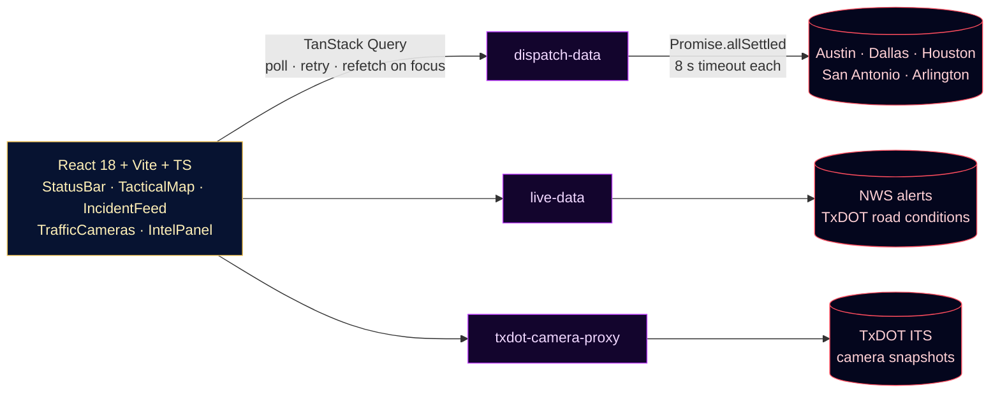

<div align="center">




<p>
  <a href="https://texas-watch.vercel.app"></a>
</p>
<p>
  <a href="https://github.com/kamikaze1120/texas-watch/commits/main"></a>
  
  
</p>

</div>

**Texas Watch** is a public-safety situational-awareness console. It pulls live computer-aided-dispatch (CAD) calls from five Texas cities, National Weather Service alerts, TxDOT road conditions, and TxDOT traffic-camera snapshots through three Supabase Edge Functions, normalizes them, and renders everything on one Leaflet tactical map beside a streaming incident feed and an analyst panel.

<p align="center"><sub><code>PUBLIC SAFETY</code> ✦ <code>OPEN GOVERNMENT DATA</code> ✦ <code>GEOSPATIAL</code> ✦ <code>REACT + TYPESCRIPT</code> ✦ <code>EDGE FUNCTIONS</code></sub></p>

<h2 align="center">✦ ON THE CONSOLE ✦</h2>
<p align="center"><sub>EVERYTHING HERE IS WIRED TO A LIVE PUBLIC FEED</sub></p>

<table>
<tr>
<td width="33%" valign="top">

📡 **Multi-city CAD feed**<br/>
<sub>Austin (Socrata), Dallas (Socrata), Houston (ArcGIS), San Antonio (CKAN) and Arlington (ArcGIS), merged into one normalized, de-duplicated stream.</sub>

</td>
<td width="33%" valign="top">

🗺️ **Tactical map**<br/>
<sub>Leaflet with severity-coded markers, click-to-fly on incidents, and automatic fly-to when the city filter changes.</sub>

</td>
<td width="33%" valign="top">

📷 **Traffic cameras**<br/>
<sub>TxDOT ITS camera snapshots via a proxy function — Austin, Dallas, Fort Worth, Houston, San Antonio, El Paso — refreshed every 30 s.</sub>

</td>
</tr>
<tr>
<td valign="top">

⛈️ **Weather alerts**<br/>
<sub>Active Texas alerts from <code>api.weather.gov</code> — event, severity, urgency, areas, expiry — with an alert banner across the top.</sub>

</td>
<td valign="top">

🚧 **Road conditions**<br/>
<sub>Closures and hazards from TxDOT's Road Conditions ArcGIS service.</sub>

</td>
<td valign="top">

📰 **Incident feed**<br/>
<sub>Newest-first, filterable by city and incident type; selecting a row flies the map to it.</sub>

</td>
</tr>
<tr>
<td valign="top">

🧠 **Intel Analyst panel**<br/>
<sub>Rule-based sit-reps and quick queries (critical calls, weather) computed from the live feeds — no LLM involved.</sub>

</td>
<td valign="top">

🎬 **Boot sequence**<br/>
<sub>A startup animation that covers the first data load.</sub>

</td>
<td valign="top">

📱 **Responsive layout**<br/>
<sub>Multi-pane console on desktop; Map / Feed / Cams / Intel tabs on mobile.</sub>

</td>
</tr>
</table>

<h2 align="center">◈ ARCHITECTURE ◈</h2>
<p align="center"><sub>BROWSER → EDGE FUNCTIONS → PUBLIC GOVERNMENT APIS</sub></p>



| Feed | Client refresh | Edge-function behaviour |
|---|---|---|
| Dispatch calls | every 15 s + immediate refetch when the tab becomes visible | 5 sources in parallel, 8 s timeout each, normalize → dedupe → sort |
| Weather alerts | every 60 s | NWS `alerts/active?area=TX` |
| Road conditions | every 2 min | TxDOT ArcGIS feature service |
| Camera snapshots | image refresh every 30 s | proxied JPEG snapshots per district |

<details>
<summary><b>Engineering notes — how the messy data is tamed</b></summary>

<br/>

- **One shape for five schemas.** Socrata, CKAN, ArcGIS FeatureServer and MapServer all publish different fields, timestamp formats and coordinate conventions. Per-source adapters in [`dispatch-data`](supabase/functions/dispatch-data/index.ts) coerce them into one `DispatchCall` type, and a keyword classifier (`mapCallSeverity`) maps free-text call types onto `critical` / `high` / `medium` / `low`.
- **No map blackouts.** Every upstream fetch has an 8-second `AbortController` timeout inside `Promise.allSettled`, so one slow source returns an empty slice instead of stalling the whole response.
- **Defensive geospatial rendering.** An `isValidLatLng` guard filters bad coordinates before they reach Leaflet; records without coordinates get a deterministic approximate position near their city centre.
- **Safe timestamps.** `safeTimestamp` normalizes Dallas's date + time fields into valid ISO 8601 (falling back to "now"), so the newest-first sort can't be corrupted.
- **Honest fallbacks.** If Houston's ArcGIS feed fails, placeholder entries are labelled with the source `Houston PD (Est.)`. The function also tries a Texas DPS alerts URL and falls back to an empty list if it isn't available.
- **Token-driven theme.** Colors are HSL CSS variables in [`src/index.css`](src/index.css), consumed through Tailwind semantic classes.

</details>

<h2 align="center">◆ TECH STACK ◆</h2>
<p align="center"><sub>TYPED FRONTEND · SERVERLESS DENO BACKEND</sub></p>

<p align="center">
  
</p>

| Layer | Technology |
|---|---|
| Framework | React 18 · TypeScript 5 · Vite 5 (SWC) |
| UI | Tailwind CSS 3 · shadcn/ui (Radix) · Lucide icons |
| Data | TanStack Query 5 |
| Maps | Leaflet 1.9 · react-leaflet 4.2 |
| Backend | Supabase Edge Functions (Deno) · Supabase JS |
| Tooling | ESLint 9 · Vitest · Testing Library · jsdom |

<h2 align="center">✦ QUICK START ✦</h2>
<p align="center"><sub>NODE 18+ · A SUPABASE PROJECT FOR THE EDGE FUNCTIONS</sub></p>

```bash
git clone https://github.com/kamikaze1120/texas-watch.git
cd texas-watch
npm install
cp .env.example .env     # fill in your Supabase project values
npm run dev              # http://localhost:8080
```

Deploy the three edge functions with the Supabase CLI — each is set to `verify_jwt = false` in [`supabase/config.toml`](supabase/config.toml) so the public dashboard can call them without a user token:

```bash
supabase functions deploy dispatch-data
supabase functions deploy live-data
supabase functions deploy txdot-camera-proxy
```

<details>
<summary><b>Scripts & environment variables</b></summary>

<br/>

| Command | Purpose |
|---|---|
| `npm run dev` | Vite dev server (port 8080) |
| `npm run build` | Production build |
| `npm run build:dev` | Development-mode build |
| `npm run preview` | Preview the production build |
| `npm run lint` | ESLint |
| `npm run test` / `npm run test:watch` | Vitest (currently a placeholder test only) |

| Variable | Purpose |
|---|---|
| `VITE_SUPABASE_URL` | Supabase project URL — the edge functions are called at `/functions/v1/*` |
| `VITE_SUPABASE_PUBLISHABLE_KEY` | Supabase publishable (anon) key for the JS client |
| `VITE_SUPABASE_PROJECT_ID` | Supabase project ref |

These are publishable client values; never put a `service_role` key in a `VITE_` variable. On Vercel, set them under Project → Settings → Environment Variables. The upstream government sources need no API keys.

</details>

<details>
<summary><b>Project structure</b></summary>

<br/>

```text
src/
├── components/dashboard/
│   ├── StatusBar.tsx        clock, system status
│   ├── StatsBar.tsx         per-city incident counts
│   ├── TacticalMap.tsx      Leaflet map, markers, camera layer, fly-to
│   ├── IncidentFeed.tsx     filterable incident list
│   ├── TrafficCameras.tsx   TxDOT camera grid
│   ├── IntelPanel.tsx       rule-based sit-rep panel
│   ├── AlertBanner.tsx      NWS weather-alert banner
│   └── BootSequence.tsx     startup animation
├── components/ui/           shadcn/ui primitives
├── hooks/                   useDispatchData · useLiveData · useCameras
├── integrations/supabase/   Supabase client
├── pages/Index.tsx          composition root
└── index.css                HSL design tokens

supabase/functions/
├── dispatch-data/           multi-city CAD aggregator
├── live-data/               NWS + TxDOT (+ DPS attempt) aggregator
└── txdot-camera-proxy/      camera list + snapshot proxy
```

</details>

<h2 align="center">◈ DATA SOURCES ◈</h2>
<p align="center"><sub>PUBLIC ENDPOINTS · NOT AFFILIATED WITH ANY AGENCY</sub></p>

<table>
<tr>
<td valign="top">

**Dispatch / incidents**
- City of Austin — Real-Time Traffic Incidents (Socrata)
- City of Dallas — Police Active Calls (Socrata)
- City of Houston — Crime Data (ArcGIS FeatureServer)
- City of San Antonio — SAPD Calls for Service (CKAN)
- City of Arlington — Police Incidents (ArcGIS MapServer)

</td>
<td valign="top">

**Conditions**
- NOAA / National Weather Service — `api.weather.gov` active alerts
- TxDOT — Road Conditions (ArcGIS)
- TxDOT — ITS district camera snapshots

</td>
</tr>
</table>

This project is for educational and demonstration purposes. It is not an emergency service — in an emergency, call 911.

<h2 align="center">◆ ROADMAP ◆</h2>
<p align="center"><sub>IDEAS, NOT YET BUILT</sub></p>

- Push updates (Supabase Realtime) instead of polling
- Persisted incident history + trend analytics
- LLM-written narrative briefings on selected incidents
- Role-based access for restricted views
- Push notifications for critical-severity events

<br/>

<div align="center">


<sub><code>◉ TEXAS-WATCH // GILDED ORBIT</code> · <a href="https://github.com/kamikaze1120">github.com/kamikaze1120</a></sub>

</div>
